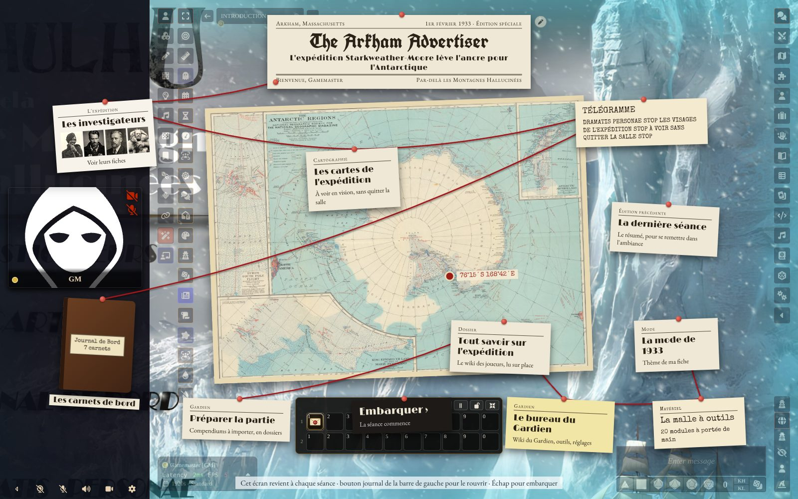
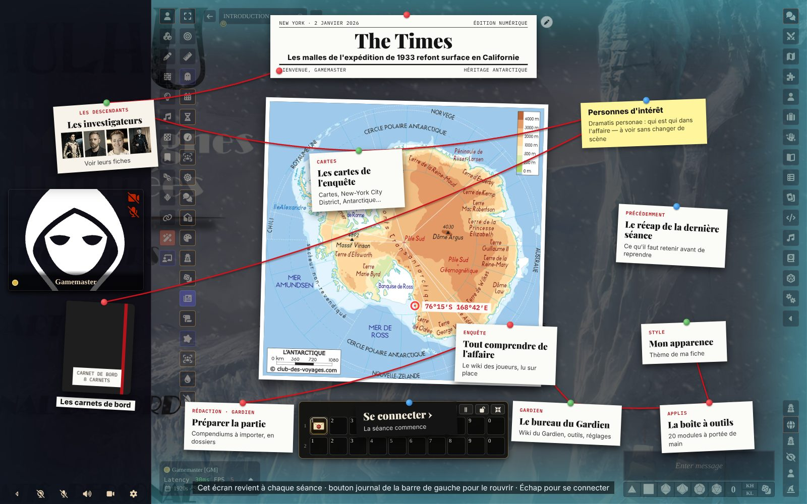
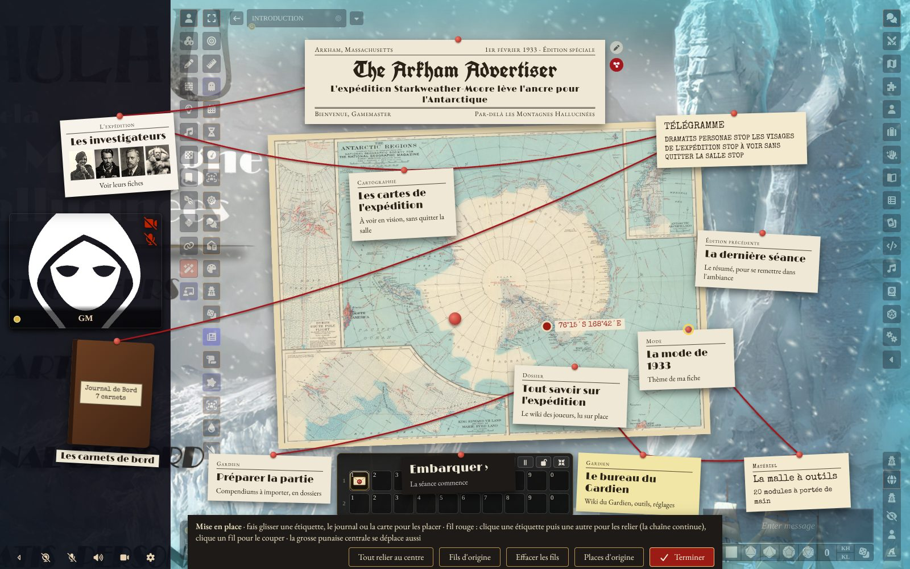

# CoC7 – Accueil « À la une » (1933 / 2026)

Écran d'accueil plein écran, **sur fond transparent** (on voit la scène), à chaque session, pour les joueurs et le Gardien.
Une une de journal, une carte de l'Antarctique, un fil rouge et des coupures punaisées qui servent de boutons. Module privé (campagne *Par-delà les Montagnes Hallucinées*).

| | 1933 | 2025-2026 |
|---|---|---|
| 📰 Journal | *The Arkham Advertiser* | *The Times* (édition numérique) |
| 🗺️ Carte | National Geographic, *The Antarctic Regions* | carte physique (© club-des-voyages.com, usage privé) |
| 🪪 Ma fiche | photo punaisée | badge du Hartford Heritage Trust |
| 📓 Mon carnet de bord | « Journal de Bord […] » | « Carnet de Bord […] » |

 

## Pour les joueurs
- 🪪 **Ma fiche** : portrait, PV, SAN, Chance ; un clic ouvre la fiche (personnage de l'époque réglé dans la Bascule d'époque).
- 📓 **Mon carnet de bord** : avec une pastille pour les pages ajoutées depuis la dernière ouverture.
- 🔭 **Dramatis personae** et **les cartes** en *vision* : la scène s'affiche dans un encadré (lanterne magique en 1933, tablette en 2026), avec ses tuiles, sans changer de scène ; onglets, zoom, tuiles cliquables.
- 📜 **La dernière séance** (Résumé des époques), 📚 **le wiki des joueurs** lu sur place, 🎨 **le thème de ma fiche**.
- 🧰 **La boîte à outils** (« La malle à outils » en 1933) : les modules CoC7 utiles, avec un bouton « Ouvrir » ; le Gardien choisit ceux que les joueurs voient.
- 🔎 **Taille des étiquettes** : réglage personnel de 50 à 100 % (80 % par défaut), pour les petits écrans.

## Pour le Gardien

- 🎩 Les investigateurs et les carnets de l'époque, **préparer la partie** (compendiums importés chacun dans son dossier), **le bureau du Gardien** (wiki du Gardien, boîte à outils, réglages).
- ✏️ **Le crayon** à droite du journal : changer sur place le nom du journal, le gros titre, l'édition, la date et le lieu. La date vient du calendrier des deux époques (vide = calendrier) ; les joueurs voient le changement aussitôt.
- 📍 **Le point rouge** de la carte : le faire glisser là où sont les joueurs ; latitude et longitude se recalculent d'après la projection de la carte (ou texte libre dans les réglages). Il n'est pas relié au fil.
- 🧵 **La mise en place** (bouton rond sous le crayon) :
  - faire glisser les étiquettes, le journal et la carte où l'on veut ;
  - fil rouge : cliquer une étiquette puis une autre pour les relier (la chaîne continue), cliquer un fil pour le couper ;
  - une grosse punaise centrale, déplaçable, peut servir de point de départ (« Tout relier au centre ») ;
  - « Fils d'origine », « Effacer les fils », « Places d'origine », « Terminer » (ou Échap).
  Chaque époque garde sa disposition ; les joueurs la voient aussitôt.
- 👁️ Dans la boîte à outils, un œil sur chaque module de la partie joueurs le montre ou le cache aux joueurs.

Bouton **journal** dans la barre de gauche (ou Alt + U) pour rouvrir l'écran ; réglage « Écran d'accueil à chaque session » pour le couper.
Aucune animation en boucle.

## Installation
Dépôt privé : installer depuis le zip de la release (dossier `coc7-accueil-une/` dans `Data/modules/`), ou depuis l'URL du manifeste si le dépôt devient public.

## Droits
Code sous licence MIT. Polices sous licence SIL OFL (fichiers `fonts/LICENSE-*`). Carte de 1933 : National Geographic, *The Antarctic Regions*. **La carte de 2026 (`assets/antarctique-2026.webp`, © club-des-voyages.com) n'est pas couverte par la licence MIT : usage privé à la table uniquement, ne pas publier.**

Historique détaillé : `ETAT.md`. Tests : `S:\FoundyTest\harness` (voir LISEZMOI.md).
